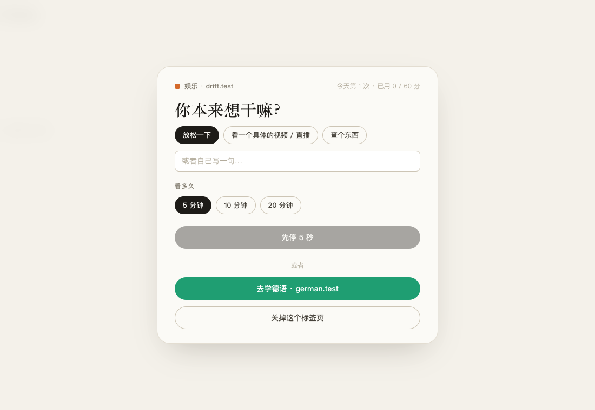
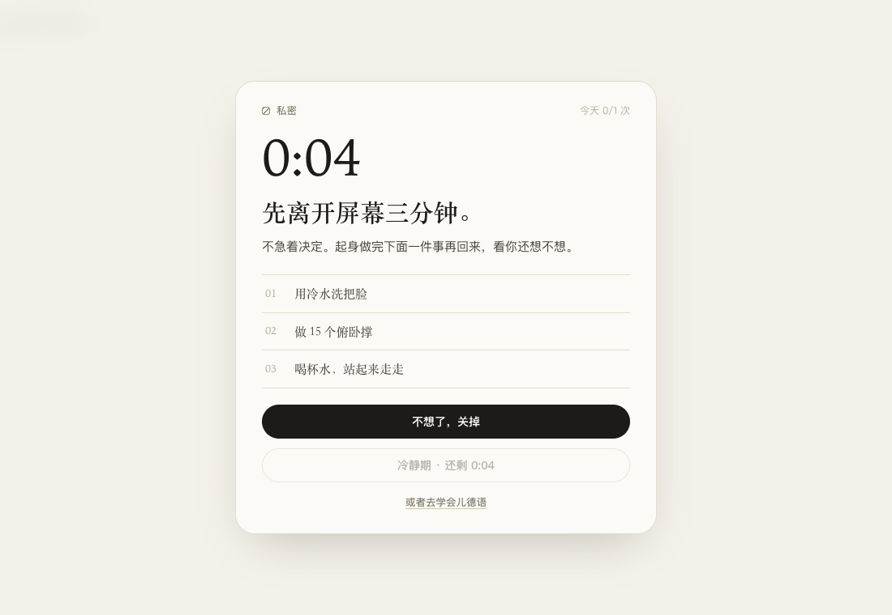
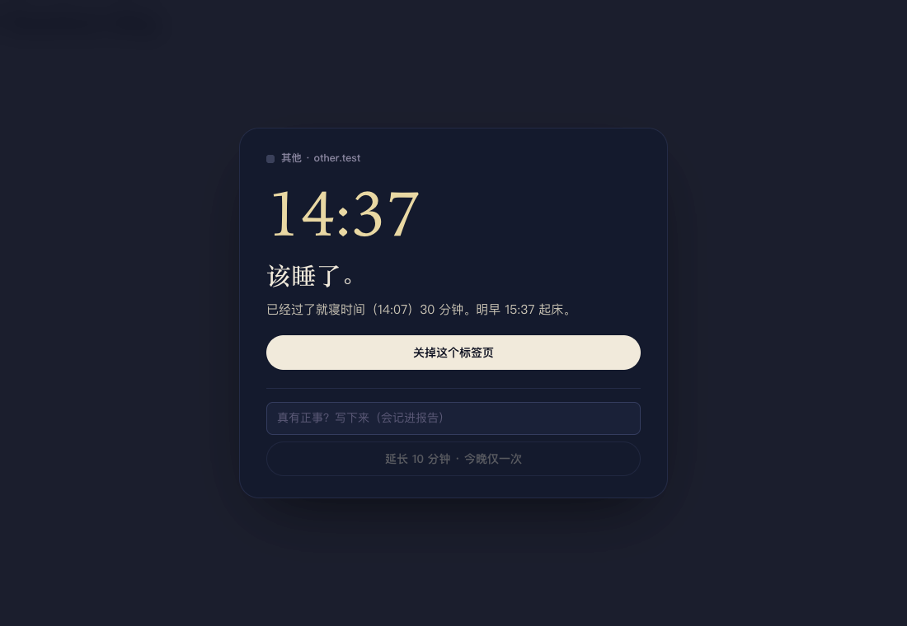
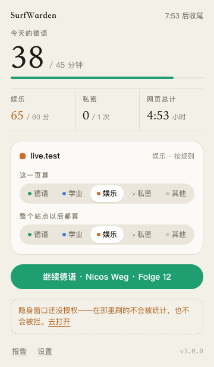
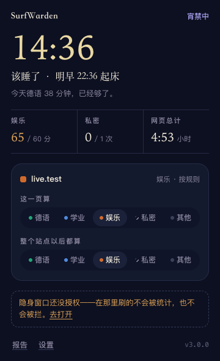
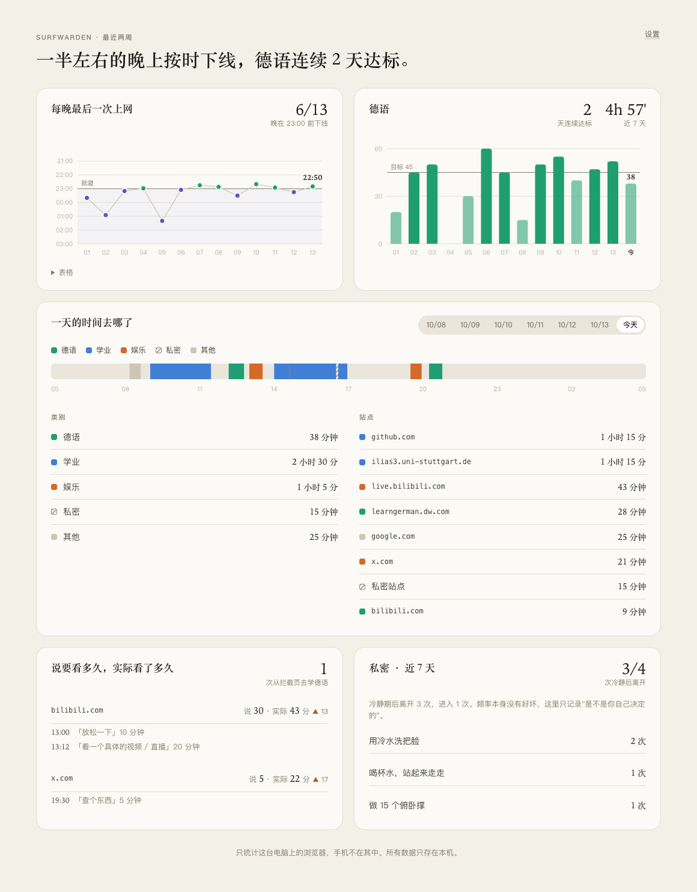

# SurfWarden

一个只在本机运行的浏览器扩展，帮我做三件事：

1. **晚上按时下线**：22:30 关掉娱乐站，23:00 起宵禁到 07:30，只留下白名单站点。
2. **把漫无目的刷 B 站直播、刷 X 视频的时间换成学德语**：白天打开娱乐站要先说清楚"想干嘛、看几分钟"，到点就拦，主按钮直接带你回到上次的 Nicos Weg。
3. **私密网站先冷静一下**：打开成人网站时，先出现 3 分钟冷静期，建议你离开屏幕去洗把冷水脸、做几个俯卧撑。回来还想看可以进，一天一次。不评判频率，也不在任何地方显示网址。

另外，它会如实记录网页时间花在了哪里，包括每晚最后一次上网是几点。

界面跟着作息变：白天是暖白纸面配宋体，收尾和宵禁时变成深夜蓝和月光色（ADR-0015）。

> v3.0.0 是一次重写，详见 [ADR-0012](docs/adr/ADR-0012-v3-repositioning.md)。v2 的文档在 [docs/archive/v2/](docs/archive/v2/)。

## 它怎么工作

| 时段（可改） | 娱乐站（B 站、X、YouTube 等） | 其他网页 |
|---|---|---|
| 白天 07:30–22:30 | 意图闸门：写意图、选 5/10/20 分钟，每次等待逐次加长（5→60 秒）；每天总额 60 分钟 | 放行 |
| 收尾 22:30–23:00 | 拦截 | 放行，右下角显示"离上床 N 分钟" |
| 宵禁 23:00–07:30 | 拦截 | 只放行德语、学业类和白名单站点；每晚可写理由延长 1 次，每次 10 分钟 |

私密站点：白天先冷静 3 分钟，再决定进不进（进入后 20 分钟，每天 1 次）；收尾和宵禁期间一律拦截。

- **按内容分类，而不是按域名一刀切。** B 站和 YouTube 视频页会读取 UP 主或频道。第一次遇到某个 UP 主会问"这是德语学习吗？"，回答会被记住。已经预置了 B 站「德国百科DEPedia」（搬运了 Nicos Weg）和 YouTube「Easy German」。
- **计时尽量真实。**
  - 只计聚焦窗口里当前标签页的时间。
  - 看视频不碰鼠标也照常计时；锁屏就停表。
  - 合盖休眠的那段空窗不会被算进去。
- **报告页：** 每晚最后上网时间对比 23:00、德语每日分钟数和连续达标天数、一天的 24 小时时间线、意图日志（"说要看 10 分钟，实际看了多久"）、宵禁延长的理由。
- **只在本地：** 零网络请求，不需要账号。数据存在 IndexedDB 和 chrome.storage 里，可以导出为 JSON。
- **只覆盖这台电脑的浏览器，** 手机上的使用不在统计里。

## 安装

```bash
npm install
npm run build
```

然后在 Chrome 或 Edge 里加载：

1. 打开扩展管理页，开启"开发者模式"。
2. 点"加载已解压的扩展"，选择 `.output/chrome-mv3`。
3. 打开扩展详情，开启"**允许在隐身模式下运行**"。不开的话，隐身窗口就是后门。

## 开发

```bash
npm run compile        # 类型检查
npm test               # 单测（core 层行覆盖约 96%）
npm run build          # 构建
npm run e2e            # 真机 E2E：本机 Edge + 本地站点，不访问外网
npm run check:privacy  # 隐私红线：源码不含网络 API
node e2e/shoot.mjs     # 用演示数据生成文档截图
```

文档入口：[产品方案](docs/PRODUCT.md) · [架构](docs/design/architecture.md) · [开发流程](docs/dev-process.md) · [ADR](docs/adr/)

## 截图

| 意图闸门 | 私密 · 冷静期 | 宵禁 |
|---|---|---|
|  |  |  |

| Popup · 白天 | Popup · 夜里 |
|---|---|
|  |  |


